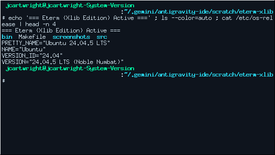
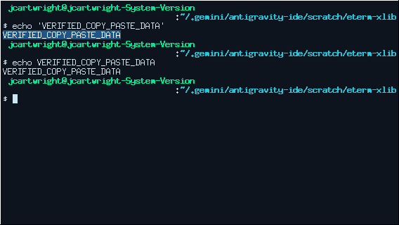
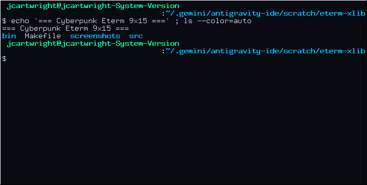
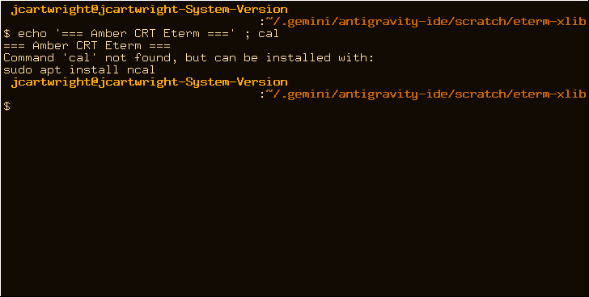

# Eterm-Xlib: Translucent Xlib Terminal Emulator

A fast, lightweight terminal emulator built with pure **Xlib** in the iconic aesthetic style of **Eterm** (Enlightened Terminal). Features a composited **translucent background**, crisp **fixed bitmap terminal fonts**, and complete **Xterm-compatible mouse copy & paste bindings**.

---

## Key Features

- **Translucent Background (Eterm Style)**:
  - Uses native X11 32-bit `TrueColor` ARGB visuals for true glass-like window transparency.
  - Foreground text glyphs render at 100% solid alpha for maximum contrast and legibility, while the dark tinted background lets underlying windows and wallpapers show through.
  - Includes `_NET_WM_WINDOW_OPACITY` atom support for seamless compatibility across modern X11 compositors (Mutter, KWin, Picom, Compiz).
  - Dynamically adjustable opacity on-the-fly via keyboard shortcuts (`Ctrl+Shift+Up`/`Down`).

- **Fixed Bitmap Terminal Fonts**:
  - Direct integration with core X11 fixed fonts (`7x13`, `6x13`, `8x13`, `9x15`, `10x20`, `fixed`).
  - Pixel-perfect monospace alignment and font metrics.
  - Instant runtime font scaling via `Ctrl+Shift+(+)` and `Ctrl+Shift+(-)`.

- **Xterm-Style Mouse Copy & Paste**:
  - **Left-Click & Drag (Button 1)**: Select text character-by-character. Text is highlighted with an electric blue selection box.
  - **Double-Click (Button 1)**: Selects an entire word.
  - **Triple-Click (Button 1)**: Selects the entire line.
  - **Release (Button 1)**: Automatically copies the selected text to both `XA_PRIMARY` and `CLIPBOARD`.
  - **Middle-Click (Button 2)**: Pastes the `PRIMARY` selection directly into the terminal shell.
  - **Right-Click (Button 3)**: Extends or contracts the active selection to the clicked position.
  - **Keyboard Paste**: `Shift+Insert` pastes `PRIMARY` selection.

- **Full ANSI & VT100 Terminal Emulation**:
  - Standard 16 ANSI colors, full 256-color palette (`38;5;n` / `48;5;n`), and 24-bit TrueColor support.
  - Alternate screen buffer mode (`?1049h` / `?47h`) for full-screen applications like `vim`, `nano`, `htop`, and `less`.
  - 2,048-line circular scrollback buffer navigable via `Shift+PageUp`/`PageDown` or mouse wheel.
  - Dynamic window resizing with `TIOCSWINSZ` propagation and `SIGWINCH`.
  - OSC sequence parsing (`OSC 0` and `OSC 2`) for dynamic window title updates.

- **Eterm Aesthetic Framing & Built-in Themes**:
  - Classic Enlightenment-style beveled inner frame with subtle lighting highlights and drop-shadows.
  - 5 curated color palettes: `eterm-classic` (default), `cyberpunk`, `green-phosphor`, `amber`, and `dracula`.

---

## Screenshots

| Eterm Classic (`7x13` Fixed Font) | Selection Highlight & Middle-Click Paste |
| :---: | :---: |
|  |  |

| Cyberpunk Neon (`9x15` Fixed Font) | Amber CRT Theme |
| :---: | :---: |
|  |  |

---

## Building and Running

### Prerequisites

On Debian/Ubuntu systems:
```bash
sudo apt update
sudo apt install build-essential libx11-dev
```

### Compilation

```bash
cd /home/jcartwright/.gemini/antigravity-ide/scratch/eterm-xlib
make
```

The resulting binary will be created at `bin/eterm-xlib`.

### Installation (Optional)

```bash
sudo make install
```
Installs to `/usr/local/bin/eterm-xlib`. You can override `PREFIX`:
```bash
make install PREFIX=$HOME/.local
```

---

## Usage and Options

```bash
./bin/eterm-xlib [options] [-e command [args...]]
```

### Command-Line Arguments

| Option | Argument | Description | Default |
| :--- | :--- | :--- | :--- |
| `-fn`, `-font` | `<font_name>` | X11 fixed font name (e.g. `7x13`, `6x13`, `9x15`, `10x20`, `fixed`) | `7x13` |
| `-geometry` | `<cols>x<rows>` | Initial terminal grid size | `80x24` |
| `-trans` | `<0-100>` | Background opacity percentage (0 = invisible, 100 = opaque) | `80` |
| `-theme` | `<name>` | Color palette: `eterm-classic`, `cyberpunk`, `green-phosphor`, `amber`, `dracula` | `eterm-classic` |
| `-title` | `<string>` | Initial window title | `Eterm` |
| `--no-bevel` | | Disable the Enlightenment beveled frame | Enabled |
| `-e` | `<cmd> [args]` | Run a command instead of the default interactive shell | `$SHELL` |
| `-h`, `--help` | | Show usage help and options | |

### Examples

```bash
# Launch default Eterm terminal with 80% opacity
./bin/eterm-xlib

# Launch in Amber CRT theme with larger 9x15 fixed font
./bin/eterm-xlib -theme amber -fn "9x15" -trans 85

# Launch in Cyberpunk theme at 75% opacity and 100x30 columns
./bin/eterm-xlib -theme cyberpunk -geometry 100x30 -trans 75

# Run top directly in a dedicated floating translucent terminal
./bin/eterm-xlib -title "System Monitor" -e top
```

---

## Mouse Bindings (Xterm Style)

| Mouse Action | Binding | Effect |
| :--- | :--- | :--- |
| **Left Click & Drag** | Button 1 | Starts character-by-character selection. Cells invert / glow. |
| **Left Double-Click** | Button 1 (x2) | Selects the entire word under the cursor. |
| **Left Triple-Click** | Button 1 (x3) | Selects the entire line. |
| **Left Release** | Button 1 Up | Commits selection to `XA_PRIMARY` and `CLIPBOARD`. |
| **Middle Click** | Button 2 | Pastes the current `PRIMARY` selection into the terminal shell. |
| **Right Click** | Button 3 | Extends or contracts the selection boundary to the clicked cell. |
| **Mouse Wheel Up** | Button 4 | Scrolls up into the terminal scrollback history (3 lines per tick). |
| **Mouse Wheel Down** | Button 5 | Scrolls down toward the active terminal screen. |

---

## Keyboard Shortcuts

| Shortcut | Action |
| :--- | :--- |
| `Shift + Insert` | Paste `PRIMARY` selection into the terminal |
| `Shift + PageUp` | Scroll up in history by half a page |
| `Shift + PageDown` | Scroll down in history by half a page |
| `Ctrl + Shift + Up` | Increase background opacity (+5%) |
| `Ctrl + Shift + Down` | Decrease background opacity (-5%) |
| `Ctrl + Shift + (+)` | Switch to a larger fixed font (`6x13` → `7x13` → `8x13` → `9x15` → `10x20` → `12x24`) |
| `Ctrl + Shift + (-)` | Switch to a smaller fixed font |

---

## Architecture

The codebase is written in pure C99 and organized into clean modules:

- [`src/main.c`](file:///home/jcartwright/.gemini/antigravity-ide/scratch/eterm-xlib/src/main.c): Application entry point, CLI parser, signal management, and `select()` multiplexing loop.
- [`src/term.c`](file:///home/jcartwright/.gemini/antigravity-ide/scratch/eterm-xlib/src/term.c) / [`src/term.h`](file:///home/jcartwright/.gemini/antigravity-ide/scratch/eterm-xlib/src/term.h): Terminal grid state, ANSI/VT100 parser, scrollback buffer, and cursor management.
- [`src/x11_ui.c`](file:///home/jcartwright/.gemini/antigravity-ide/scratch/eterm-xlib/src/x11_ui.c) / [`src/x11_ui.h`](file:///home/jcartwright/.gemini/antigravity-ide/scratch/eterm-xlib/src/x11_ui.h): 32-bit ARGB TrueColor window creation, fixed font loading, double-buffered rendering, and Eterm bevel framing.
- [`src/selection.c`](file:///home/jcartwright/.gemini/antigravity-ide/scratch/eterm-xlib/src/selection.c) / [`src/selection.h`](file:///home/jcartwright/.gemini/antigravity-ide/scratch/eterm-xlib/src/selection.h): Xterm selection state machine, multi-click word/line bounds, and X11 `SelectionRequest` / `SelectionNotify` handlers.
- [`src/pty_mgr.c`](file:///home/jcartwright/.gemini/antigravity-ide/scratch/eterm-xlib/src/pty_mgr.c) / [`src/pty_mgr.h`](file:///home/jcartwright/.gemini/antigravity-ide/scratch/eterm-xlib/src/pty_mgr.h): PTY master/slave allocation (`forkpty`), termios configuration, and `TIOCSWINSZ` window dimension synchronization.
- 
